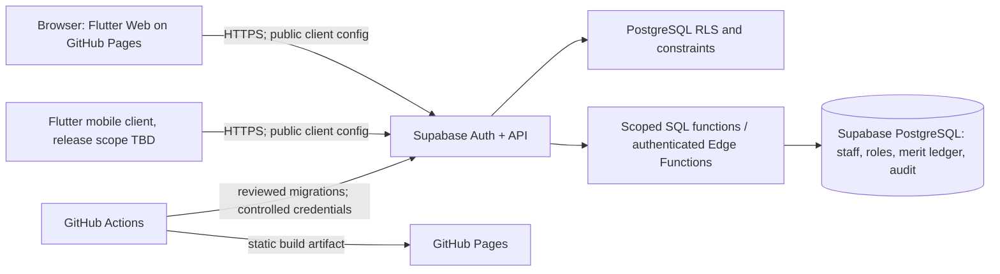

# Technical Architecture — Merit Tracker

**Status:** Proposed architecture for review
**Stack direction:** Flutter + GitHub Pages + Supabase

## 1. System boundary



GitHub Pages serves static assets only; it does not host a trusted backend. Supabase is the runtime authority for identity, authorization and staff data. The app must treat Supabase as unavailable sometimes and show safe recoverable states.

## 2. Proposed repository layout

```text
apps/
  merit_app/             Flutter app: web first; mobile targets by decision
supabase/
  config.toml
  migrations/            versioned SQL schema and policy changes
  functions/              narrowly scoped authenticated Edge Functions
docs/
.github/workflows/        analysis, verification and Pages deployment
```

One repository is a proposal. Keep the layout small; a TypeScript monorepo tool is optional and should be added only for actual shared tooling. Supabase functions use their supported toolchain; Flutter uses Flutter/Dart tooling.

## 3. Client responsibilities

- Render responsive web/mobile interface, validate inputs for usability and invoke authenticated operations.
- Initialize `supabase_flutter` with the project URL and publishable key. This key is expected to be visible in the public web bundle; RLS and server-side checks provide security.
- Never contain a Supabase secret/service-role key, SMTP password or staff data in the shipped bundle.
- Do not treat client role flags, hidden buttons, route guards or local storage as authorization.
- Use generated typed models where practical and keep UI state separate from database authorization.
- Display explicit pending/success/failure states. On retry, avoid duplicating mutations; use operation IDs/idempotency where relevant.

## 4. Supabase responsibilities

- **Auth:** invite-only sign-in; public signup disabled. Define approved bootstrap, invite, reset, session revocation and redirect allowlists.
- **PostgreSQL:** authoritative staff, user-to-staff links, permissions, organization score settings, current score, immutable merit events and audit events.
- **RLS:** enabled for every exposed table with default-deny policies and tests for self-only and admin scopes.
- **Trusted operations:** narrowly scoped SQL functions for atomic score/import operations or authenticated Edge Functions where external side effects are required. Derive identity from the validated JWT; never trust user IDs or role booleans sent by the app.
- **Secrets:** Edge Function secrets/dashboard or protected deployment environment only. Service-role keys bypass RLS; never ship them to clients or Pages.

## 5. Data model (logical)

| Entity | Core fields / rules |
|---|---|
| `organizations` | ID, name, default starting score in integer tenths, optional floor/ceiling, created timestamp. Multi-tenant organization scope is not confirmed; single-organization deployment is assumed for v1. |
| `profiles` | `auth_user_id` linked to staff/user identity; active state; no client-controlled role claim. |
| `roles`, `permissions`, `role_permissions`, `profile_roles` | Explicit function permissions; changes restricted and audited. |
| `staff` | ID, organization ID, display/name fields needed by the business, status, starting score, current score in integer tenths, created/updated metadata. |
| `merit_events` | Append-only event: staff, actor, signed delta or opening/correction type, before/after tenths, required reason, UTC timestamp, optional correction link and idempotency key. |
| `audit_events` | Actor, action, target, timestamp, safe metadata; exclude passwords, tokens, secrets and full CSV row contents. |
| `import_batches` | Initiator, status, counts, created/committed timestamps; avoid retaining raw uploaded files unless separately justified. |

Apply foreign keys, check constraints, organization scoping, indexes and retention rules through migrations. Confirm whether a current-score column is maintained transactionally or derived from the ledger; whichever is chosen must reconcile and be tested.

## 6. Atomic merit adjustment

The Flutter client submits target staff, signed delta, reason and an idempotency token. A trusted database function or authenticated Edge Function:

1. Validates JWT, permission and staff scope from server-side identity data.
2. Validates delta is exactly one of `±10, ±20, …, ±100` tenths and reason is non-empty/size-limited.
3. Locks the score row or uses a serializable-safe update; checks configured bounds.
4. Inserts a ledger event and updates current score in the same transaction.
5. Returns the committed before/after values; repeated idempotency token returns the existing result rather than applying twice.

Clients receive no direct insert/update permission for score or merit-event fields. Corrections append compensating events; history is never silently rewritten.

## 7. Authentication, invitations and email

Public self-signup is disabled. Admin user provisioning must use a trusted administrative workflow, never an admin secret from Flutter. Supabase admin user-management operations require a trusted server or Dashboard. Automated invitations/password recovery need a configured production SMTP provider; the provider's built-in test mail is not a production guarantee. The no-SMTP owner bootstrap and recovery workflow is an unresolved decision and must be safely designed before account lifecycle acceptance.

## 8. GitHub Pages routing and release

- Build Flutter Web with the correct repository path as the HTML base href for a project Pages URL.
- Prefer Flutter's hash URL strategy because Pages does not natively rewrite arbitrary paths to `index.html`; use path URLs only with a tested redirect/404 design.
- Configure Supabase Auth site URL and redirect allowlist for local, staging and production origins.
- Publish only compiled static artifacts; exclude source maps and secrets.
- Use GitHub Actions Pages artifact/deploy workflow with minimum required permissions, protected production environment and reviewed workflow changes. Pin third-party actions to immutable commit SHAs before production.
- Treat public config (Supabase URL and publishable key) as visible. Do not put privileged keys in Actions artifacts or build arguments.

## 9. Environments, migration and operations

Keep separate Supabase projects for development, staging and production. Run reviewed forward migrations, test on staging against representative synthetic data, and have a recovery/forward-fix plan before production migration. Configure backups according to chosen plan and retention, then regularly restore into a non-production environment. Provider plan features and costs must be rechecked before release.

## 10. Reliability and performance

- Set measurable availability, expected data volume, CSV/report limits, RPO/RTO and latency objectives before launch.
- Use deadlines/timeouts, bounded exponential backoff for safe reads, mutation idempotency, graceful auth expiry and clear backend outage states.
- Avoid storing durable business data only in device/browser caches. Clear sensitive cached content on sign-out and account change.
- Monitor service health and quota/error signals without logging personal merit reasons unnecessarily.
- Test Pages base path, asset loading, refresh/deep-link routes, slow/offline network, session expiry, duplicate submission and recovery after a failed request.

## 11. Architecture references

- [Flutter web deployment](https://docs.flutter.dev/deployment/web), [URL strategy](https://docs.flutter.dev/ui/navigation/url-strategies)
- [GitHub Pages custom workflows](https://docs.github.com/en/pages/getting-started-with-github-pages/using-custom-workflows-with-github-pages)
- [Supabase Flutter quickstart](https://supabase.com/docs/guides/getting-started/quickstarts/flutter)
- [Supabase RLS](https://supabase.com/docs/guides/database/postgres/row-level-security), [Edge Function auth](https://supabase.com/docs/guides/functions/auth), [function secrets](https://supabase.com/docs/guides/functions/secrets)
- [Supabase SMTP](https://supabase.com/docs/guides/auth/auth-smtp), [regions](https://supabase.com/docs/guides/platform/regions), [backups](https://supabase.com/docs/guides/platform/backups)
